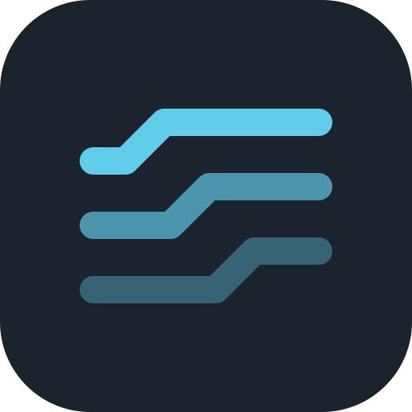

# Strata

Strata is a StarCraft II map editor written in Rust. The same code runs in the
browser (WebAssembly), installs as an app (PWA), and runs natively on Windows,
macOS and Linux. The goal is an editor that is faster and easier to use than
the official Galaxy Editor, and that AI assistants can drive through MCP.

> Strata is an early work in progress. The list below separates what works
> today from what is planned. Back up your maps and keep the official editor
> around for anything Strata cannot do yet.

## Strata and the official editor

| | Galaxy Editor | Strata |
|---|---|---|
| Platforms | Windows and macOS, with a Battle.net install | Any modern browser, installable app, or native build. No game install needed to open maps. |
| Finding things | Nested menus and modules | One command palette (Ctrl+K) with every command and its shortcut |
| Layout | Separate module windows | Dockable panels around the map; triggers never hide the map |
| Undo | Per editor module | One history for every change, including edits made by AI clients |
| AI assistants | None | MCP server, live link into the running editor (in progress) |
| File format | SC2Map archives and folders | Same files, written back losslessly; plus a JSON project format |

What works today:

- App shell: menu bar, mode rail, dockable panels, status bar, dark and light themes.
- Command palette with fuzzy search, recently used commands and shortcuts.
- New map dialog (size presets or custom, tileset, base level).
- Opening `.SC2Map` files and Strata projects (`.strata.json`) by dialog or
  drag and drop; unpacked map folders on native.
- Saving: native writes to disk; the web version downloads the file.
  If writing `.SC2Map` fails, Strata offers a lossless project export instead.
- Autosave and restore, unsaved-changes guard, recent files.
- Installable web app with offline support.

Planned or in progress (built in parallel and landing incrementally):
terrain sculpting, painting and cliffs, unit and doodad placement, regions and
cameras, the trigger editor, the data editor, Galaxy script view, text and
localization, validation in the Problems panel, the live MCP link, and full
`.SC2Map` read/write coverage.

## Screenshots

Screenshots will be added once the map viewport lands.

## Build and run

You need a recent stable Rust toolchain (1.85 or newer).

### Native

```sh
cargo run --release -p strata-app
```

The binary is called `strata`. On Linux you may need the usual windowing
development packages (for example `libxkbcommon-dev`, `libgtk-3-dev` for file
dialogs).

### Web

```sh
rustup target add wasm32-unknown-unknown
cargo install trunk --locked      # trunk 0.22 or newer
cd crates/strata-app
trunk serve                       # development server on http://127.0.0.1:8080
trunk build --release             # production build in crates/strata-app/dist
```

Strata needs a browser with WebGL 2 (current Chrome, Edge, Firefox and Safari).
The release build is about 7 MB of WebAssembly (about 2.7 MB gzipped) and is
cached by the service worker after the first visit.

### Install as an app

Open the web version in Chrome or Edge and choose **Help › Install Strata as an
app** (or the install icon in the address bar). On Safari, use **Share › Add
to Dock** or **Add to Home Screen**. The installed app works offline. When a
new version is deployed, Strata offers to reload.

## Keyboard shortcuts

On macOS, Ctrl is Cmd. Press F1 in the app for the full list.

| Action | Shortcut |
|---|---|
| Search commands | Ctrl+K |
| New map | Ctrl+N |
| Open map | Ctrl+O |
| Save map | Ctrl+S |
| Save map as | Ctrl+Shift+S |
| Undo | Ctrl+Z |
| Redo | Ctrl+Shift+Z or Ctrl+Y |
| Keyboard shortcuts | F1 |
| Modes: Select, Sculpt, Paint, Cliffs, Pathing | 1, 2, 3, 4, 5 |
| Modes: Units, Doodads, Points, Regions, Cameras | 6, 7, 8, 9, 0 |

Undo, redo and the number keys pause while a text field has focus. Browsers
reserve some shortcuts (such as Ctrl+N); use the menu or the command palette
there.

## AI assistants (MCP)

Strata ships an MCP server so assistants such as Claude can inspect and edit
maps, headless or live inside the running editor, with every change undoable
and labeled in History. See [`crates/strata-mcp`](crates/strata-mcp).

## Project layout

```
crates/
  strata-mpq/      MPQ archive reading and writing (.SC2Map containers)
  strata-core/     Document model, undoable edits, ops API, validation, Galaxy codegen
  strata-format/   Load and save .SC2Map archives and folders to the document model
  strata-app/      The editor (egui + egui_dock); native and web
    assets/        Fonts, icons, PWA manifest, service worker, web loader
    index.html     Web entry point and loading screen (built with trunk)
  strata-mcp/      MCP server
docs/DESIGN.md     Design system: tokens, type, layout, principles
```

## Contributing

Read [docs/DESIGN.md](docs/DESIGN.md) before changing the UI. Run
`cargo test --workspace` and
`cargo check -p strata-app --target wasm32-unknown-unknown` before sending a
change; CI runs both plus a release web build.

## License

Strata is dual-licensed under the MIT license or the Apache License 2.0, at
your option.

Bundled fonts: [Barlow](https://github.com/jpt/barlow) and
[JetBrains Mono](https://github.com/JetBrains/JetBrainsMono), both under the
SIL Open Font License 1.1 (see `crates/strata-app/assets/fonts`).

Strata is not affiliated with, endorsed by, or sponsored by Blizzard
Entertainment. StarCraft is a trademark or registered trademark of Blizzard
Entertainment, Inc. in the U.S. and other countries. Strata does not include
any Blizzard game assets.
